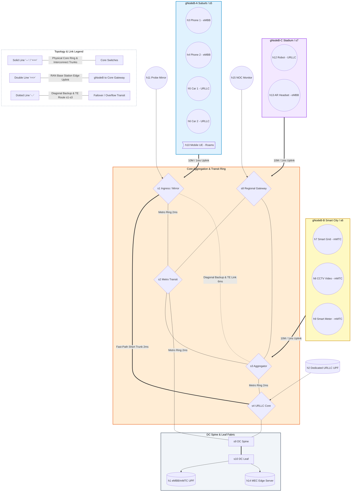

<div align="center">


# Astra: SDN-Enabled 5G Transport Slicing & Mobility Fabric

### Proactive OpenFlow 1.3 SDN testbed emulating 5G transport slicing (eMBB, URLLC, mMTC) with sub-15ms fast failover, mobility handover, and fault-injection diagnostics

[](src/astra_5g_topo.py)
[](src/astra_5g_topo.py)
[](src/astra_qos.sh)
[](src/astra_controller.py)
[](src/astra_perf.py)
[](#known-scope)

<p>
  <a href="#architecture--slicing-design">Topology</a> ·
  <a href="#running-the-lab">Run the lab</a> ·
  <a href="#observed-results-performance">Results</a> ·
  <a href="#known-scope">Scope & Emulation Model</a>
</p>

</div>

Mininet + Open vSwitch + Ryu SDN lab emulating a **5G transport network fabric**.
Three standardized 3GPP slice traffic classes (eMBB, URLLC, mMTC) share one physical ring with slice-specific routing, queuing, rate-limiting, and proactive fast failover.



## Architecture & Slicing Design
- **Core ring & transit**: s1-s2-s3-s4 + s8 (Regional Gateway) (10 Mbps links, `delay=2ms`)
- **Diagonal TE link**: s1-s3 (`delay=6ms`, used for failover & traffic engineering)
- **DC Spine & Leaf**: s9 (Spine) -> s10 (MEC / UPF Leaf)
- **Edge aggregation (gNodeBs)**:
  - `s5` (gNodeB-A Suburb) -> `s1`
  - `s6` (gNodeB-B Smart City) -> `s3`
  - `s7` (gNodeB-C Stadium / Factory) -> `s8`
- **Hosts & Slices (15 Hosts)**:
  - **URLLC**: `h5`, `h6` (Cars on s5), `h12` (Robot on s7), `h2` (Dedicated URLLC UPF on s4)
  - **eMBB**: `h3`, `h4` (Phones on s5), `h13` (AR Headset on s7), `h1` (Collector UPF on s10)
  - **mMTC**: `h7`, `h8`, `h9` (Sensors on s6)
  - **Mobility**: `h10` (Mobile vehicle roaming `s5` <-> `s6` <-> `s7`)
  - **Edge & Monitoring**: `h11` (Lawful intercept probe on s1), `h14` (MEC Server on s10), `h15` (NOC Monitor on s8)


## Use case: slice-aware 5G transport (failover, mobility, traffic engineering, IoT quarantine)

Topology additions over the base lab: **h10** (mobile car that hands over between gNodeB-A `s5`, gNodeB-B `s6`, and gNodeB-C `s7`), **h11** (monitoring probe on `s1`), and a **diagonal core link s1-s3**.

The controller (`src/astra_controller.py`) is fully **proactive** (no MAC learning, no flooding, no STP) with a two-table OpenFlow 1.3 pipeline, BFS-computed routes, and four control-plane functions:

| Function | What happens |
|---|---|
| Slice pipeline | Table 0: ACLs (slice isolation), per-phone meters (4 Mbps), DSCP marking (46/34/8). Table 1: routing; `s1` routes by slice using DSCP->metadata |
| URLLC failover | Fast-failover groups on `s1` (uplink: primary short trunk `s1-eth2` to `s4`, backup via diagonal `s1` $\rightarrow$ `s3` $\rightarrow$ `s4`) and on `s4` (downlink); protects URLLC UEs on `s5` reaching UPF `h2` on `s4` |
| URLLC mirroring | `s1` copies URLLC packets to the probe h11 |
| Mobility (AMF) | `scripts/handover.sh <s5|s6|s7>` moves h10's port; the controller reacts to PORT_STATUS and rewrites h10's routes across the entire fabric |
| Traffic engineering | Port stats on `s1`; if the eMBB path exceeds 3 Mbps, phone h4 is moved onto the diagonal (reverts below 2 Mbps) |
| IoT quarantine | Per-sensor packet rate on `s6`; a sensor above 200 pps gets a 30 s drop rule |

```bash
sudo bash scripts/run_usecase.sh        # controller + queues + interactive mininet> prompt (add --detached for the auto healthcheck)
sudo bash scripts/healthcheck.sh        # 12 checks, PASS/FAIL
sudo bash scripts/test_failover.sh      # cut s1<->s4, URLLC moves to the diagonal
sudo bash scripts/test_handover.sh      # h10 s5 -> s6 -> s5
sudo bash scripts/test_te.sh            # two phones saturate eMBB, h4 is rerouted
sudo bash scripts/test_quarantine.sh    # sensor h8 floods, gets quarantined
sudo ovs-ofctl -O OpenFlow13 dump-flows s1
sudo bash faults/inject.sh 1            # troubleshooting incident 1..4 or all (symptoms: faults/TICKETS.md)
sudo bash faults/verify.sh 1            # behavioural check that incident 1 is really fixed
```
**Troubleshooting incidents** (`faults/`): four compound scenarios, each with several root causes at different layers (groups, stale flows, meters/interfaces/queues, security policy) and **3 to 4 fix commands + a verify run** each. Tickets give symptoms only; `faults/SOLUTIONS.md` has the walkthrough.

Set `RYU_BIN=/path/to/venv/bin/ryu-manager` if Ryu is in a virtualenv. Controller events are logged with `[AMF]`, `[TE]`, `[SEC]`, `[LINK]`, `[ACL]` prefixes in `logs/ryu.log`.

## Known Scope & Emulation Model

This testbed models **5G Transport Network Slicing & Transport-Layer Management**, not an over-the-air 3GPP cellular stack:
- **What is emulated**:
  - Transport-layer slice segregation matching 3GPP service categories: **eMBB** (high throughput), **URLLC** (bounded ultra-low latency, sub-15ms), and **mMTC** (massive sensor rate-limiting).
  - SDN-based transport gateways: gNodeB edge ingress (`s5`, `s6`, `s7`) and User Plane Functions (eMBB UPF `h1`, URLLC UPF `h2`, MEC `h14`).
  - Transport-layer mobility management (AMF port-status event triggers rehoming UE L2/L3 routes across base stations).
  - Dynamic traffic engineering, QoS metering (OVS OpenFlow meters & Linux HTB queues), and IoT isolation.
- **What is out of scope (architectural boundaries)**:
  - Radio Access Network (no 3GPP NR/LTE PHY or MAC wireless layers, RF propagation, or PRB scheduling).
  - Cellular control protocols (no 3GPP NAS, NGAP/SCTP, or PFCP signaling; OpenFlow 1.3 is used for control).
  - Packet encapsulation: Ethernet/IP packet framing with static ARP is used rather than GTP-U tunnels.
  - QoS enforcement in this lab is focused on uplink transport (UE → UPF).

## Prerequisites & Installation (Arch Linux)

| Package | Purpose | Install |
|---|---|---|
| openvswitch | OVS switch 3.7+ | `pacman -S openvswitch` |
| mininet | network emulator | `pacman -S mininet` |
| iperf3 | traffic generation | `pacman -S iperf3` |
| wireshark-cli | tshark DSCP analysis | `pacman -S wireshark-cli` |
| python-ryu | RYU 4.34 controller | `pip install ryu` (venv, Python 3.9) |
| networkx / matplotlib | charts | `pip install networkx matplotlib` |

RYU and chart dependencies are installed in the local virtualenv (`.venv`). Mininet lives in system python (`/usr/bin/python3`); it is invoked directly via `sudo`.

## Repository Structure

```text
sdn/
├── src/                         # Core Python modules and SDN logic
│   ├── astra_5g_topo.py         # Mininet 10-switch, 15-host multi-domain topology
│   ├── astra_controller.py      # Proactive 2-table OF1.3 controller (AMF, TE, SEC, Mirror)
│   ├── astra_qos.sh             # Linux HTB / OVS QoS configuration
│   ├── astra_monitor.py         # Traffic monitor & DSCP analysis
│   ├── astra_perf.py            # 4-phase slice performance benchmark
│   └── astra_charts.py          # Topology and performance graph generation
├── scripts/                     # Automation & feature verification scripts
│   ├── run_usecase.sh           # Master launcher (Ryu + QoS + mininet> prompt, or --detached + healthcheck)
│   ├── healthcheck.sh           # Automated 12-point operational healthcheck suite
│   ├── handover.sh              # 3-way UE roaming mobility utility (s5 <-> s6 <-> s7)
│   ├── common.sh                # Shared helper functions (hexec, of)
│   ├── test_failover.sh         # URLLC fast-failover validation
│   ├── test_handover.sh         # Roaming ping validation
│   ├── test_te.sh               # Traffic engineering diagonal route test
│   └── test_quarantine.sh       # IoT rate-based quarantine test
├── faults/                      # Troubleshooting incident suite (3-4 commands each)
│   ├── TICKETS.md               # NOC incident problem statements & diagnostic hints
│   ├── SOLUTIONS.md             # Targeted 3-4 command incident solutions
│   ├── inject.sh                # Multi-layer fault injector (1, 2, 3, 4, all)
│   └── verify.sh                # Automated behavioral verification per scenario
├── results/                     # Benchmark measurements and figures
│   ├── astra_results.json       # Aggregate throughput & latency metrics
│   ├── astra_monitor_output.txt # Path DSCP capture analysis
│   └── figures/                 # Generated performance and topology plots
├── pcaps/                       # Packet captures (URLLC short path / eMBB long path)
└── logs/                        # Runtime execution logs (git-ignored)
```

## Running the Lab

Run all commands from the repository's root directory with the root privileges required by Mininet and Open vSwitch.

### Option A: Interactive lab with the `mininet>` prompt (Recommended)
```bash
sudo bash scripts/run_usecase.sh
```
This starts the Ryu controller and the QoS queues in the background and runs Mininet in your terminal, so you get the `mininet>` prompt (`h5 ping -c 2 h2`, `links`, `dump`, `exit`). Open a **second terminal** for the helper scripts (`sudo bash scripts/healthcheck.sh`, `scripts/test_*.sh`, `faults/inject.sh`) and for `tail -f logs/ryu.log`. Typing `exit` at the prompt stops Mininet and the controller.

For a hands-off run that ends with the 12-check healthcheck (no prompt, Mininet in the background):
```bash
sudo bash scripts/run_usecase.sh --detached
```

### Option B: Troubleshooting Incident Lab
Inject an incident scenario and verify resolution after troubleshooting:
```bash
# 1. Inject incident 1, 2, 3, or 4
sudo bash faults/inject.sh 1

# 2. Check failure state
sudo bash faults/verify.sh 1

# 3. Apply targeted 3-4 command fix (refer to faults/SOLUTIONS.md)

# 4. Confirm complete resolution
sudo bash faults/verify.sh 1
```

### Option C: Manual Step-by-Step

1. **Start the Ryu controller**:
   ```bash
   .venv/bin/ryu-manager src/astra_controller.py > logs/ryu.log 2>&1 &
   ```

2. **Start Mininet** (10 switches, 15 hosts):
   ```bash
   rm -f mn_fifo && mkfifo mn_fifo
   nohup sudo python3 src/astra_5g_topo.py < mn_fifo > logs/mn.log 2>&1 &
   ( exec 3>mn_fifo; sleep 86400 ) &
   ```

3. **Deploy slice QoS**:
   ```bash
   sudo bash src/astra_qos.sh
   ```

4. **Run End-to-End Healthcheck**:
   ```bash
   sudo bash scripts/healthcheck.sh
   ```

5. **Generate Charts & Topology Diagram**:
   ```bash
   .venv/bin/python src/astra_charts.py
   ```
   *Charts will be saved to `results/figures/`.*

## Observed Results (Performance)
 
| Metric | No QoS (Congested) | Rate-Limited (Meter Only) | Priority QoS (Queues Active) | Full Contention (All Slices) |
|---|---|---|---|---|
| URLLC Throughput | 1.18 Mbps | 8.19 Mbps | 6.50 Mbps | 6.48 Mbps |
| URLLC Avg Latency | 2029.7 ms | 104.9 ms | 21.6 ms | 12.8 ms |
| URLLC Jitter | 244.9 ms | 160.5 ms | 32.3 ms | 19.8 ms |
| eMBB Throughput | 9.51 Mbps | 2.72 Mbps | 2.46 Mbps | 3.79 Mbps |
| mMTC Throughput | 1.00 Mbps | 1.00 Mbps | 1.00 Mbps | 0.00 Mbps (Contended) |
| mMTC Packet Loss | 0.0% | 0.0% | 0.0% | 0.0% |

*Note: URLLC latency improves ~158x from congested baseline (2030 ms) to slice-prioritized full contention (12.8 ms / sub-15ms SLA).*
